# VIGILOR v1.0.0

Autonomous web VAPT platform: CLI agent and Docker web UI.

**Authorized use only.** Obtain written permission before scanning any system.

---

## Contents

| Directory | Description |
|---|---|
| `cli/` | Terminal 5-phase pentest pipeline |
| `ui/` | Docker dashboard (scans, findings, reports, evidence gates) |

> Burp Suite extensions are a separate product and are **not** included in this package.

---

## Screenshots

UI captures live under [`docs/screenshots/`](./docs/screenshots/).

| | |
|---|---|
| 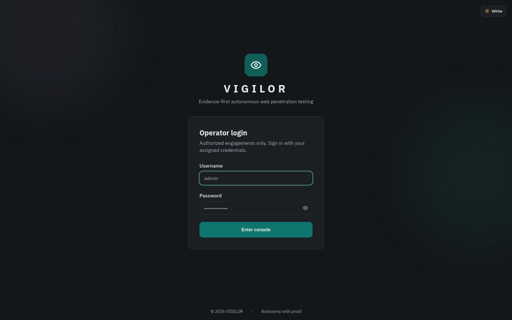 | 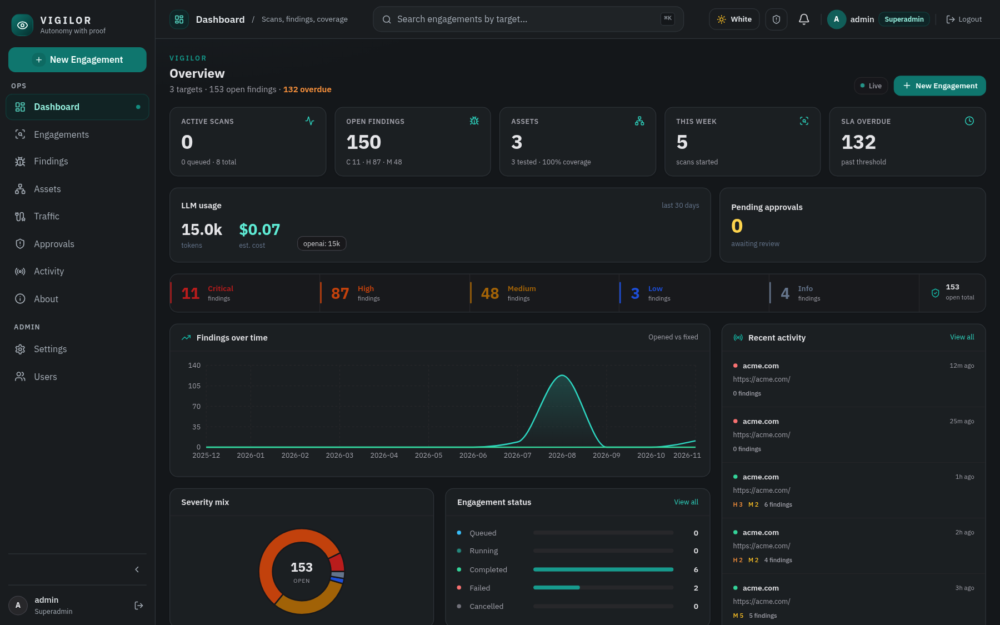 |
| *Login* | *Dashboard (dark)* |
| 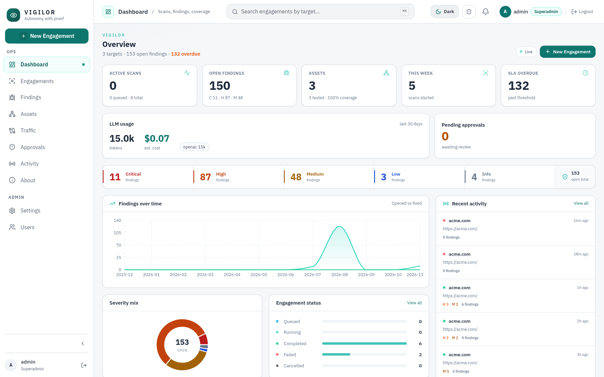 | 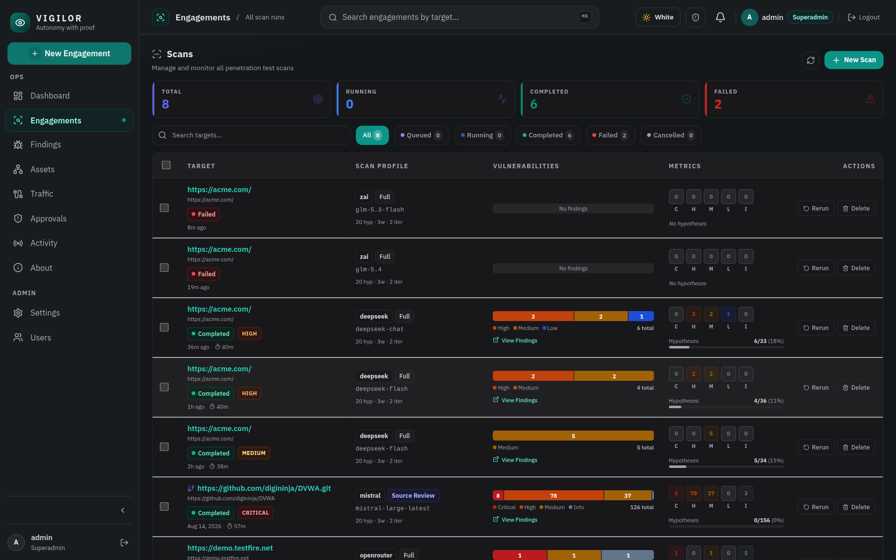 |
| *Dashboard (light)* | *Engagements* |
| 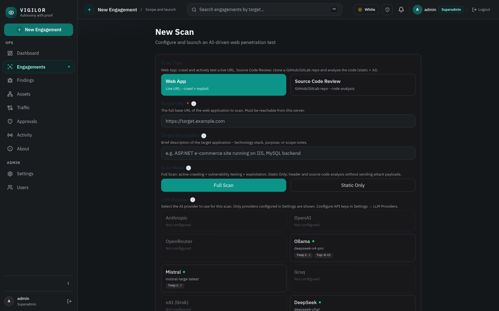 | 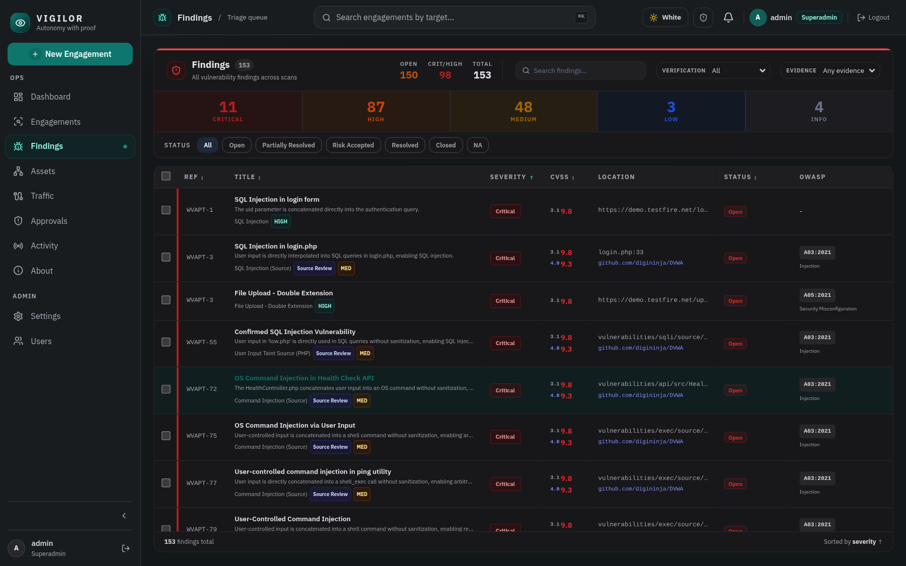 |
| *New engagement* | *Findings* |
| 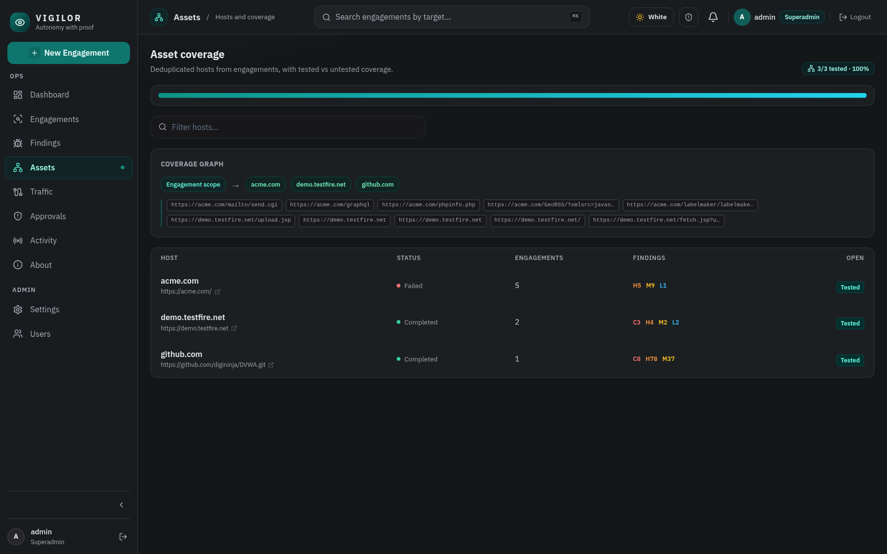 | 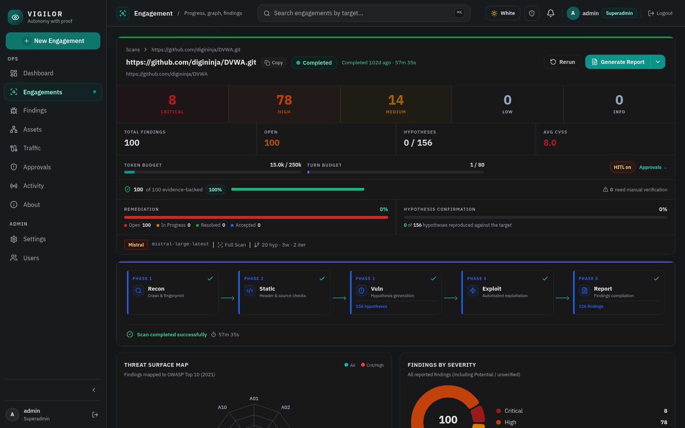 |
| *Assets / coverage* | *Engagement detail* |
| 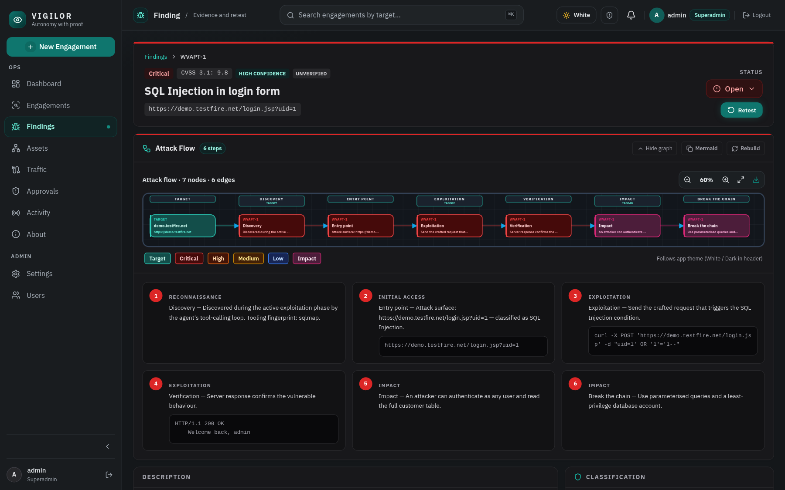 | 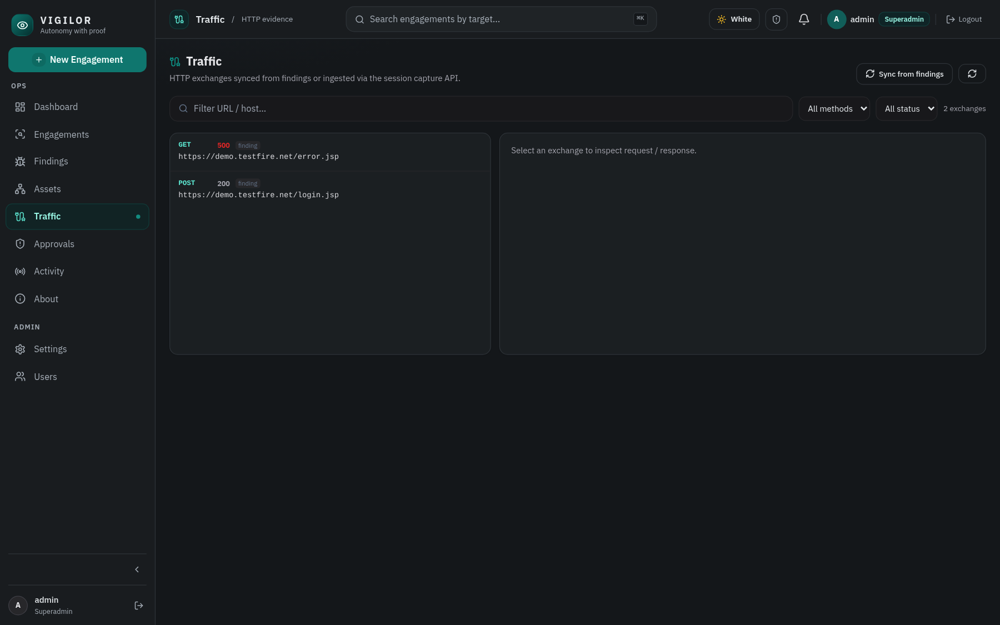 |
| *Finding detail* | *Traffic* |
| 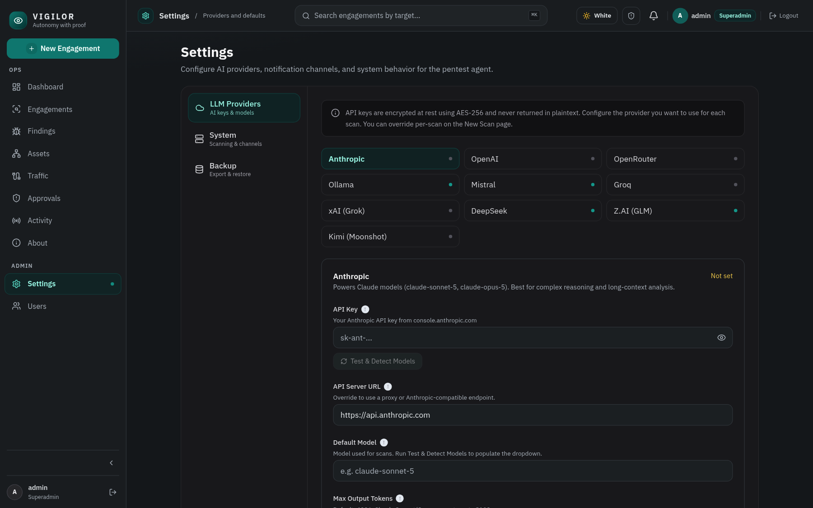 | 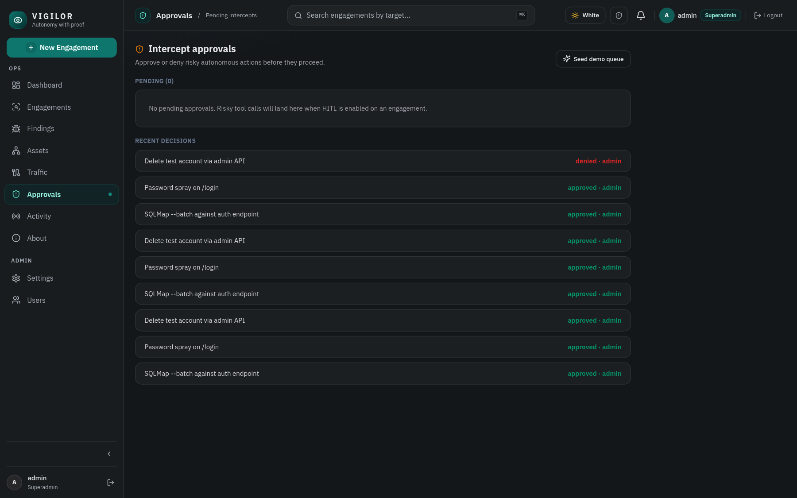 |
| *Settings* | *Approvals (HITL)* |

Also included: Activity, About (`09-activity.png`, `08-about.png`).

---

## ui/ - Web dashboard (Docker)

```bash
cd ui
cp .env.example .env   # set SECRET_KEY, ENCRYPTION_KEY, ADMIN_PASSWORD
./start.sh             # http://localhost:3000
./start.sh --rebuild   # after updates
./stop.sh
```

| Service | Port |
|---|---|
| Frontend (Nginx) | 3000 |
| Backend (FastAPI) | 8000 |
| PostgreSQL | internal |

### LLM providers

Anthropic, OpenAI, OpenRouter, Mistral, Groq, xAI, DeepSeek, Z.AI (GLM), Kimi, Ollama.

For fewer false positives:

- DeepSeek: `deepseek-chat` @ temperature 0.2
- Z.AI: `glm-4.7` / `glm-5` @ temperature 0.2 (requires Z.AI balance / resource pack)
- Avoid flash/mini models at high temperature for exploit confirmation

### Evidence quality

Confirmed findings need type-matching proof. Narrative-only results become Potential. Verification: Unverified / Verified / False Positive.

Z.AI billing errors (`1113` insufficient balance) fail the scan immediately with a clear message.

---

## cli/ - Command-line agent

```bash
cd cli
python3 -m venv venv && source venv/bin/activate
pip install -r requirements.txt
playwright install chromium
cp .env.example .env
python3 main.py --url https://target.example --provider anthropic
```

---

## Changelog

See [CHANGELOG.md](./CHANGELOG.md).
